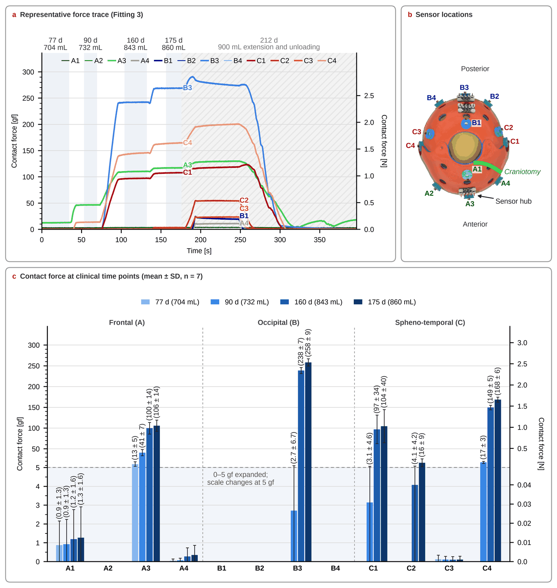
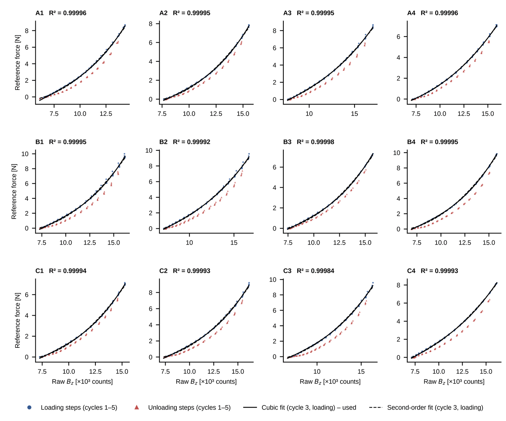
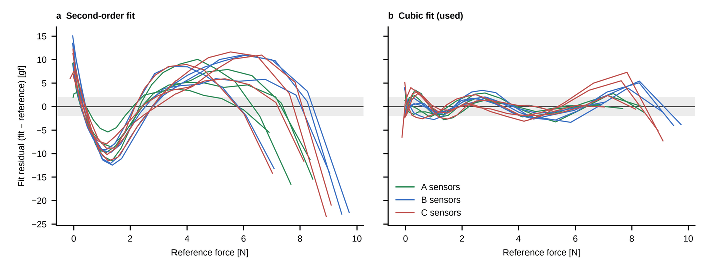
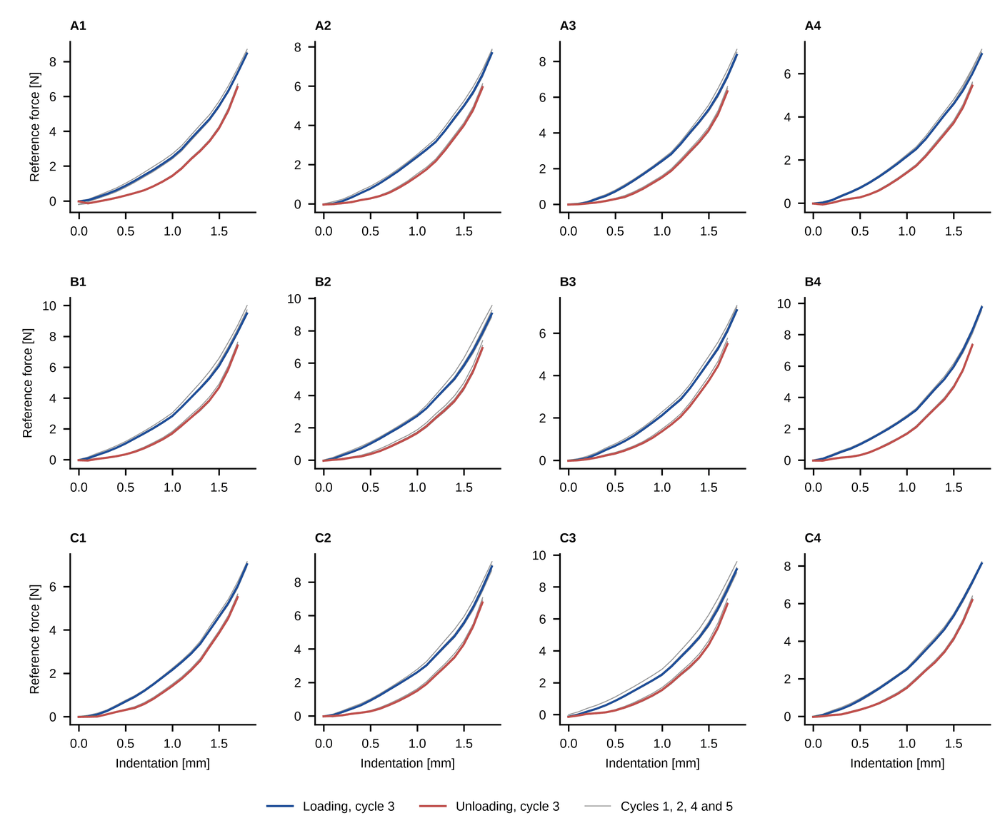
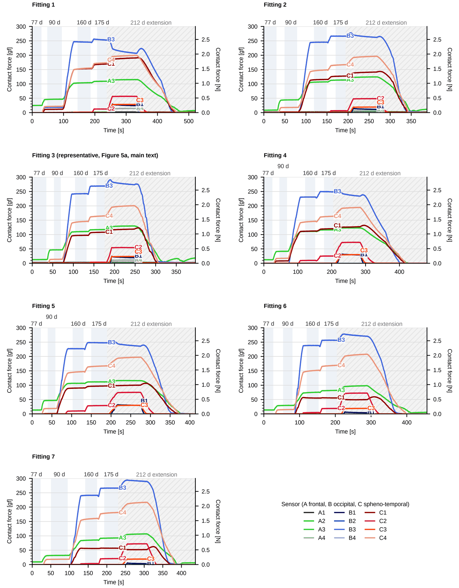
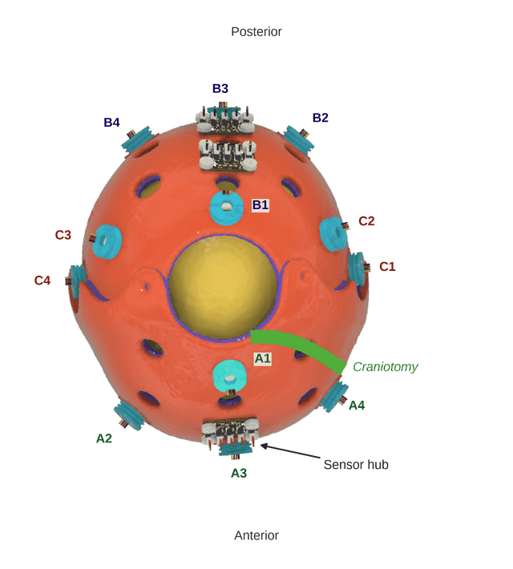

# Helmet contact force analysis

Analysis code and force data for the helmet–head-model contact-force experiments in:

> Colakoglu A. A. *et al.* **Evaluation of an Instrumented Helmet for Measurement of
> Orthosis–Head Interface Forces in Pediatric Craniosynostosis.**
> *(manuscript under review; citation will be updated on publication)*

A replica of a clinical cranial helmet was fitted with 12 soft magnetic (Hall-effect)
force sensors and placed on a patient-derived head model whose intracranial volume was
expanded step by step from 704 mL to 860 mL (and on to 900 mL in the Supporting
Information). The helmet was removed and refitted before each run. This repository turns
the logs recorded by
[Sensor Tracking Studio](https://github.com/aarifcolakoglu-research/sensor-tracking-studio)
into Figure 5, Figures S9–S12, Table S4 and the force values reported in the manuscript.



*Figure 5 as produced by `python run_all.py`: (a) force trace of the representative fitting,
(b) sensor locations, (c) contact force at the four clinical time points (mean ± SD, n = 7).
Reduced-resolution preview; the full-resolution files are written to `outputs/`.*

## Quick start

```bash
python -m venv .venv
# Windows: .venv\Scripts\activate    macOS/Linux: source .venv/bin/activate
pip install -r requirements.txt
python run_all.py
```

All results are written to `outputs/` (PNG at 600 dpi and LZW-compressed TIFF; tables as CSV).
The figures use Arial; on systems without Arial, Liberation Sans or DejaVu Sans is used.
Expected console summary (excerpt):

```
n = 7 fittings: Fitting 1 = R1, ..., Fitting 6 = R7, Fitting 7 = R8
860 mL: A1 1.3 ± 1.6 gf; A3 105.7 ± 13.6 gf; B3 258.3 ± 8.7 gf; C1 104.5 ± 39.9 gf; C2 16.3 ± 9.4 gf; C4 168.5 ± 5.9 gf
  860 mL: Frontal 16 [14-18]; Occipital 40 [35-44]; Spheno-temporal 44 [41-49]
Highest single-site force up to 860 mL: 269 gf (2.64 N), B3, Fitting 3 (R3)
A1 7.2769e-12 -1.4094e-07 1.5697e-03 -6.4157e+00 R2=0.99996      (cubic fit, Table S4)
```

## What each file does

| File | Produces |
|---|---|
| `pipeline.py` | Shared processing: reads a log, splits it into the operator-labelled volume segments and averages each sensor over every stable hold; common figure style |
| `tables.py` | `sensor_forces.csv` (mean ± SD, min, max and CV for every sensor and volume step, including 900 mL), `regional_shares*.csv` (frontal / occipital / spheno-temporal share of the summed sensor force), `peak_force.csv` |
| `fig5a_trace.py` | Figure 5a: continuous force trace of the representative fitting |
| `fig5c_bar.py` | Figure 5c: per-sensor force at 704, 732, 843 and 860 mL; `fig5c_values.csv` |
| `fig5_compose.py` | Figure 5 composite and panels a, b and c as separate images |
| `figS9_S11_calibration.py` | Figures S9–S11 (calibration curves, residuals, hysteresis of the twelve sensors); prints the cubic coefficients and R² of Table S4 |
| `figS12_all_fittings.py` | Figure S12: force traces of all seven fittings |
| `run_all.py` | Runs all of the above |

## Supporting Information figures

Previews of the Supporting Information figures produced by `python run_all.py`
(reduced resolution; full-resolution PNG and TIFF files are written to `outputs/`).

**Figure S9.** Calibration curves of the twelve sensors (`figS9_S11_calibration.py`).



**Figure S10.** Calibration fit residuals, second-order versus the cubic fit used (`figS9_S11_calibration.py`).



**Figure S11.** Loading–unloading hysteresis of the twelve sensors over five cycles (`figS9_S11_calibration.py`).



**Figure S12.** Force traces of all seven fittings (`figS12_all_fittings.py`).



## Data

`data/raw/` holds the seven Sensor Tracking Studio logs (Fittings 1–7) of the helmeted series
(24 September 2026). One row is one sensor sample:

| Column | Meaning |
|---|---|
| `timestamp` | PC clock time at serial arrival (HH:MM:SS.mmm) |
| `sensor_id`, `short_id` | calibrated sensor (`S1_MatC_A1`) and its site (`A1`) |
| `volume` | operator's label: a stable hold (`732`) or a transition (`704-732`) |
| `raw_bz` | raw Hall-effect output |
| `force_n`, `gram` | force from the sensor-specific cubic calibration, after tare, in N and gf |
| `displacement_mm`, `displacement_um` | estimated indentation of the contact element |

`data/runs_manifest.csv` lists the seven fittings in chronological order (R1–R7) with
the fitting number used in the paper (`fitting`, 1–7) and the session (`AM`, `MID`, `PM`).

`data/calibration_S1_MatC_step_medians.csv` holds the step medians (reference force,
indentation and raw B<sub>z</sub> per loading/unloading step and cycle) of the twelve
sensors' calibration recordings, exported from Sensor Tracking Studio
(`datasets/metadata_fz_median.csv`). The raw calibration recordings (about 2.2 GB) are
available from the corresponding author on reasonable request.

**Processing in brief.** The first labelled segment is the 704 mL pre-loading baseline. For
each fitting and sensor, the force at a volume is the mean of all samples in the first stable
segment with that label. Values are reported as mean ± sample SD across the seven fittings.
Regional shares are the summed forces of each sensor group divided by the summed force of all
12 sensors in the same fitting. The representative fitting in Figure 5a is the one closest to
the series mean (root-mean-square difference over the 704–860 mL means).

**Sensor groups.** A1–A4 frontal, B1–B4 occipital, C1–C4 spheno-temporal
(C1, C2 on the patient's left; C3, C4 on the right).



*Sensor sites (Figure 5b). The unlabelled render in `assets/sensor_locations.png` is the
input image; `fig5_compose.py` draws the labels on it.*

## Related repositories

- [sensor-tracking-studio](https://github.com/aarifcolakoglu-research/sensor-tracking-studio): acquisition, calibration and live monitoring software that recorded these logs
- [tactile-sensor-calibration-rig](https://github.com/aarifcolakoglu-research/tactile-sensor-calibration-rig): control and acquisition software for the three-axis calibration rig

## Citation

If you use this code or data, please cite the article above and this repository
(see `CITATION.cff`).

## Licence

Code: [PolyForm Noncommercial 1.0.0](https://polyformproject.org/licenses/noncommercial/1.0.0) — free for research, teaching, personal and other non-commercial use; commercial use is not permitted.
Data (`data/`) and the images in `assets/` and `docs/images/`: [CC BY-NC 4.0](https://creativecommons.org/licenses/by-nc/4.0/). See `LICENSE`.
